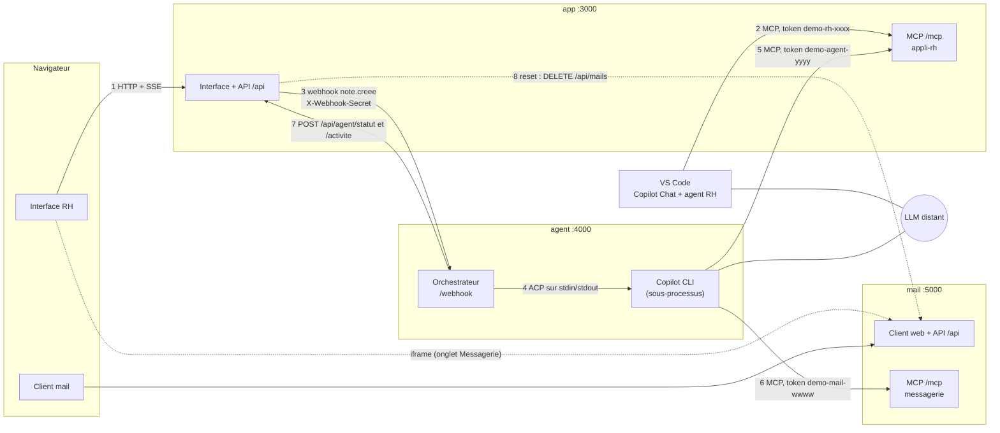

# Plateforme de démonstration « IA, agents et MCP »

Démo locale de vulgarisation : une application RH classique, exposée à une IA par un serveur MCP, puis pilotée depuis VS Code (agent RH) et par un agent autonome réveillé par webhook. Tout tourne en local avec des données factices ; seul le LLM est distant. Pas de HTTPS, tokens en clair : c'est voulu.

La spécification complète est dans `spec-plateforme-demo-ia.md` (v0.2).

## État d'avancement

| Composant | Dossier | État |
|---|---|---|
| Application RH + serveur MCP + webhook | `app/` | ✅ disponible |
| Faux serveur de messagerie (MCP + client mail web) | `mail/` | ✅ disponible |
| Agent autonome (orchestrateur + Copilot CLI en ACP) | `agent/` | ✅ disponible (testé avec un faux Copilot CLI, pas avec le vrai) |
| Agent RH et skills pour VS Code | `vscode-demo/` | ✅ disponible (non testé dans VS Code) |

## Prérequis

- Node.js 22 ou plus (`node -v`)
- `curl` (inclus dans Windows 10/11)
- Pour l'agent autonome : **GitHub Copilot CLI** installé et authentifié (`copilot`), avec le support ACP

## Installation (« compilation »)

Il n'y a **pas de compilation** : c'est du JavaScript exécuté tel quel, sans build. Seule l'installation des dépendances est nécessaire.

```cmd
npm run install:all
```

(équivalent à `npm install` dans `app/`, `mail/` puis `agent/`)

## Lancement

Une seule commande, depuis la racine du projet :

```cmd
npm start
```

ou, sous Windows, double-clic / commande sur le script qui installe les dépendances au besoin puis démarre :

```cmd
demarrer-app.cmd
```

**Tout lancer d'un coup** (application + messagerie + agent autonome, sortie préfixée dans un seul terminal) :

```cmd
npm run start:all
```

ou `demarrer-tout.cmd` (installe les dépendances au besoin, crée `agent/.env`). Ctrl+C arrête les trois.

L'application est alors disponible sur :

- Interface web : <http://localhost:3000>
- Serveur MCP : <http://localhost:3000/mcp>

Changer de port : `set PORT=3100 && npm start` (cmd) ou `PORT=3100 npm start` (bash).

Les données sont stockées dans `app/data/db.json` (créé au premier lancement, ignoré par git). Le bouton **Réinitialiser la démo** de l'interface remet l'état de départ ; supprimer ce fichier produit le même effet au prochain démarrage.

## Tests

```cmd
npm test
```

Trois séries de tests, sans Copilot ni réseau :

- `app/` (port 3999, base jetable) : refus sans token, outils MCP, droits par token, webhook, suivi de l'agent, réinitialisation.
- `mail/` (port 5993) : MCP et token, mails visibles dans l'API, HTML conservé, erreurs explicites, doublons.
- `agent/` (ports 3994, 4994 et 5994) : politique d'autorisation, file d'attente, rejet d'un webhook sans secret, et la **chaîne complète** (webhook → orchestrateur → session ACP → appels MCP → `.eml` → annotation) avec un faux Copilot CLI (`agent/test/faux-copilot.js`).

## Qui parle à qui



| # | De → vers | Quoi | Se règle dans |
|---|---|---|---|
| 1 | Navigateur → app | Interface, API, rafraîchissement en direct (SSE) | URL `http://localhost:3000` |
| 2 | VS Code → app | Outils MCP de l'application (lecture + écriture) | `vscode-demo/.vscode/mcp.json` (URL + token) |
| 3 | app → orchestrateur | Webhook « note créée » | Interface : **Paramètres** (URL, secret) ; le secret doit égaler `WEBHOOK_SECRET` de `agent/.env` |
| 4 | orchestrateur → Copilot CLI | Pilotage ACP, une session par note | `agent/.env` : `COPILOT_BIN`, `COPILOT_ARGS`, `WORKSPACE_DIR` |
| 5 | Copilot CLI → app | Outils MCP de l'application (lecture + annotation) | `agent/.env` : `APP_MCP_URL`, `APP_MCP_TOKEN` |
| 6 | Copilot CLI → mail | Outil `envoyer_mail` | `agent/.env` : `MAIL_MCP_URL`, `MESSAGERIE_TOKEN` (égal à celui de `mail/`) |
| 7 | orchestrateur → app | Avancement de l'agent (badge, journal) | `agent/.env` : `APP_URL` |
| 8 | app → mail | Vide la boîte à la réinitialisation | variable d'environnement `MAIL_URL` de l'app (défaut `http://localhost:5000`) |

Les liens 5 et 6 ne sont pas ouverts par l'orchestrateur : il transmet ces URL et tokens à Copilot CLI à l'ouverture de chaque session ACP, et c'est Copilot CLI qui appelle les serveurs MCP.

**Ports** : application 3000 · messagerie 5000 · orchestrateur 4000.

**Les 3 tokens** : `demo-rh-xxxx` (VS Code → app, défini dans `app/config/tokens.json`) · `demo-agent-yyyy` (Copilot CLI → app, idem) · `demo-mail-wwww` (Copilot CLI → mail, variable `MESSAGERIE_TOKEN` côté `mail/` et côté `agent/`).

## Utiliser l'interface

- **Tableau de bord** : prochaines arrivées, tâches à venir, dernières notes.
- **Personnel / Tâches** : fiches et tâches (les schémas Mermaid sont dessinés).
- **Notes** : zone de saisie libre. Les annotations de l'agent autonome s'affichent sous chaque note.
- **Paramètres** : interrupteur du webhook (désactivé par défaut), URL de l'agent (`http://localhost:4000/webhook`), secret partagé.
- **Messagerie** : le client mail de démonstration (voir ci-dessous) intégré dans l'interface.
- **Panneau « Sous le capot »** (à droite) : appels MCP reçus, refus de droits, webhooks émis et **étapes de l'agent autonome** (🤖), en direct.
- Sur chaque note, un **badge** suit l'agent : « en attente », « traite cette note… » (clignotant), « traitée par l'agent », ou « échec » / « délai dépassé ».

## Voir le serveur MCP avec curl

Les tokens de démo (fichier `app/config/tokens.json`) :

| Token | Nom | Droits |
|---|---|---|
| `demo-rh-xxxx` | `agent-rh-vscode` | lecture, écriture |
| `demo-agent-yyyy` | `agent-autonome` | lecture, annotation |

Le serveur répond en Streamable HTTP, il faut donc les deux en-têtes `Content-Type` et `Accept` ci-dessous. Chaque requête est indépendante (pas de session). Les appels apparaissent aussitôt dans le panneau « Sous le capot ».

**Windows (cmd)**

```cmd
:: 1. Poignée de main : nom du serveur et instructions générales
curl -s http://localhost:3000/mcp -H "Content-Type: application/json" -H "Accept: application/json, text/event-stream" -H "Authorization: Bearer demo-rh-xxxx" -d "{\"jsonrpc\":\"2.0\",\"id\":1,\"method\":\"initialize\",\"params\":{\"protocolVersion\":\"2025-03-26\",\"capabilities\":{},\"clientInfo\":{\"name\":\"curl\",\"version\":\"1\"}}}"

:: 2. Liste des outils et de leurs descriptions (ce que « voit » le LLM)
curl -s http://localhost:3000/mcp -H "Content-Type: application/json" -H "Accept: application/json, text/event-stream" -H "Authorization: Bearer demo-rh-xxxx" -d "{\"jsonrpc\":\"2.0\",\"id\":2,\"method\":\"tools/list\"}"

:: 3. Appeler un outil
curl -s http://localhost:3000/mcp -H "Content-Type: application/json" -H "Accept: application/json, text/event-stream" -H "Authorization: Bearer demo-rh-xxxx" -d "{\"jsonrpc\":\"2.0\",\"id\":3,\"method\":\"tools/call\",\"params\":{\"name\":\"lister_personnel\",\"arguments\":{\"recherche\":\"sophie\"}}}"
```

**Linux / macOS / Git Bash**

```bash
H=(-H 'Content-Type: application/json' -H 'Accept: application/json, text/event-stream')

# 1. Poignée de main
curl -s http://localhost:3000/mcp "${H[@]}" -H 'Authorization: Bearer demo-rh-xxxx' \
  -d '{"jsonrpc":"2.0","id":1,"method":"initialize","params":{"protocolVersion":"2025-03-26","capabilities":{},"clientInfo":{"name":"curl","version":"1"}}}'

# 2. Liste des outils
curl -s http://localhost:3000/mcp "${H[@]}" -H 'Authorization: Bearer demo-rh-xxxx' \
  -d '{"jsonrpc":"2.0","id":2,"method":"tools/list"}'

# 3. Appeler un outil
curl -s http://localhost:3000/mcp "${H[@]}" -H 'Authorization: Bearer demo-rh-xxxx' \
  -d '{"jsonrpc":"2.0","id":3,"method":"tools/call","params":{"name":"lister_personnel","arguments":{"recherche":"sophie"}}}'
```

La réponse est au format SSE (`event: message` puis `data: {...}`).

**Montrer les droits par token** : avec `demo-agent-yyyy` (agent autonome), un outil d'écriture est refusé avec un message explicite.

```cmd
curl -s http://localhost:3000/mcp -H "Content-Type: application/json" -H "Accept: application/json, text/event-stream" -H "Authorization: Bearer demo-agent-yyyy" -d "{\"jsonrpc\":\"2.0\",\"id\":4,\"method\":\"tools/call\",\"params\":{\"name\":\"creer_tache\",\"arguments\":{\"titre\":\"test\"}}}"
```

Sans en-tête `Authorization`, le serveur répond `401`.

## Serveur de messagerie (faux)

Un petit service indépendant (`mail/`, port 5000) joue le rôle de serveur de mail. Il expose **deux choses** :

- un **serveur MCP** `messagerie` (`http://localhost:5000/mcp`, token `demo-mail-wwww`) avec les outils `envoyer_mail` et `lister_mails_envoyes` : c'est ce que l'agent autonome appelle pour prévenir les gens ;
- un **client mail web** (`http://localhost:5000`, aussi intégré dans l'onglet **Messagerie** de l'application) : la liste des mails à gauche, le contenu HTML du mail sélectionné à droite. Un nouveau mail apparaît en direct, en surbrillance, sans recharger la page. Le contenu est affiché dans un cadre isolé (sans scripts).

Le corps d'un mail est du HTML simple (`<p>`, `<ul>`, `<table>`…) ; du texte brut est converti automatiquement. Chaque mail est aussi écrit en `.eml` dans `mail/outbox/`. Le bouton « Vider la boîte » (ou « Réinitialiser la démo » de l'application) supprime les mails.

Lancement seul : `npm run start:mail` ou `demarrer-mail.cmd`.

## Agent RH dans VS Code

1. Démarrer l'application (`npm start`).
2. Dans VS Code, **ouvrir le dossier `vscode-demo/`** (pas la racine du projet) : c'est lui qui contient `.vscode/mcp.json`, l'agent et les skills.
3. Démarrer le serveur MCP `appli-rh` (palette de commandes : *MCP: List Servers* → `appli-rh` → *Start Server*). Le token de démo est pré-rempli. Le panneau « Sous le capot » de l'application montre la poignée de main et la liste des outils.
4. Ouvrir Copilot Chat en **mode Agent**.

**Sans persona ni skill** (premier temps de la démo) : avec le mode Agent par défaut, écrire « J'ai rendez-vous avec Paul mardi à 14h ». Une tâche est créée alors qu'on ne l'a pas demandé, grâce aux seules descriptions des outils.

**Avec l'agent RH** : choisir **Agent RH** dans le sélecteur d'agents du chat, puis écrire :

> Un nouvel arrivant, Jean Bonno, arrive en tant que développeur le 12 janvier en CDD pour 3 mois. Il lui faudra des accès.

Fiche (fin calculée au 11/04/2027), tâche principale et sous-tâches, demandes d'accès et note d'annonce apparaissent en direct dans l'application. Suite possible : « Fais-moi le schéma de son parcours » (skill `schema-onboarding`).

Les emplacements `.github/agents/*.agent.md` et `.github/skills/<nom>/SKILL.md` correspondent aux versions récentes de VS Code et de Copilot ; selon votre version, il peut être nécessaire d'activer les skills dans les paramètres (recherche « skills » ou « agent skills »). La note publiée par l'agent RH déclenche le webhook si celui-ci est actif : c'est la jonction avec l'agent autonome.

## Agent autonome

L'agent autonome se compose de **l'orchestrateur** (`agent/`, Node.js) et de **Copilot CLI** qu'il pilote en ACP (`copilot --acp --stdio`). Copilot CLI est le cerveau (LLM, boucle d'outils, lecture de la persona et des skills dans `agent/workspace/`) ; l'orchestrateur reçoit le webhook, ouvre une session ACP par note, répond aux demandes d'autorisation et fait remonter l'avancement dans l'application. L'envoi de mail passe par le serveur de messagerie (`mail/`), appelé par l'agent via MCP.

### Lancement

Le plus simple : `npm run start:all` (ou `demarrer-tout.cmd`). Sinon, dans **trois terminaux** :

```cmd
npm start
npm run start:mail
npm run start:agent
```

ou sous Windows : `demarrer-app.cmd`, `demarrer-mail.cmd` puis `demarrer-agent.cmd` (ce dernier crée `agent/.env` depuis `agent/.env.example` s'il n'existe pas).

Puis dans l'interface (<http://localhost:3000>), **Paramètres → cocher « Webhook actif »** (l'URL par défaut `http://localhost:4000/webhook` et le secret `demo-secret-zzzz` correspondent déjà). Publier une note, puis suivre :

- **sur la note** : le badge « 🤖 l'agent traite cette note… » puis « ✓ traitée par l'agent », et l'annotation qui apparaît dessous ;
- **dans « Sous le capot »** : chaque étape de l'agent (🤖) et chaque appel MCP ;
- **dans l'onglet Messagerie** : les mails qui arrivent en direct ;
- **dans la console de l'orchestrateur** : le flux détaillé (messages, outils, autorisations).

### Configuration (`agent/.env`)

| Variable | Défaut | Rôle |
|---|---|---|
| `PORT` | `4000` | Webhook et serveur MCP messagerie |
| `WEBHOOK_SECRET` | `demo-secret-zzzz` | Doit être égal au secret des Paramètres de l'application |
| `APP_URL` | `http://localhost:3000` | Où l'orchestrateur signale l'avancement de l'agent |
| `APP_MCP_URL` / `APP_MCP_TOKEN` | `http://localhost:3000/mcp` / `demo-agent-yyyy` | MCP de l'application, avec le token `agent-autonome` (lecture + annotation) |
| `MAIL_MCP_URL` / `MESSAGERIE_TOKEN` | `http://localhost:5000/mcp` / `demo-mail-wwww` | MCP du serveur de messagerie |
| `COPILOT_BIN` / `COPILOT_ARGS` | `copilot` / `--acp --stdio` | Commande de Copilot CLI ; ajouter ici les filtres d'outils (`--available-tools`, `--excluded-tools`) |
| `WORKSPACE_DIR` | `./workspace` | Dossier de travail de Copilot CLI (persona + skill) |
| `SESSION_TIMEOUT_S` | `180` | Délai maximal par note, puis annulation |

### Essayer la chaîne sans Copilot CLI

Un faux agent (`agent/test/faux-copilot.js`) parle ACP et appelle vraiment les deux serveurs MCP (application et messagerie), avec des règles simples (arrivée, confidentiel, information). Utile pour vérifier l'installation sans consommer de quota Copilot :

Copilot CLI est lancé depuis `agent/workspace/` : le chemin du faux agent doit donc être **absolu**. Dans `agent/.env` :

```
COPILOT_BIN=node
COPILOT_ARGS=C:\chemin\vers\ia-playground\agent\test\faux-copilot.js
```

puis `npm run start:all` comme d'habitude.

### Garde-fous

- Webhook sans secret valide : `401`.
- L'orchestrateur **autorise** les outils des serveurs `appli-rh` et `messagerie`, et **refuse** tout le reste (shell, fichiers, réseau), en affichant `✘ REFUSÉ` dans sa console.
- Le token `agent-autonome` ne permet que de lire et d'annoter : l'application refuse toute création.

### À vérifier avec votre version de Copilot CLI

Le support ACP de Copilot CLI est en préversion ; je n'ai pas pu le tester ici. Points à contrôler au premier essai :

1. Copilot CLI accepte les serveurs MCP transmis à l'ouverture de session ACP (c'est ce que fait l'orchestrateur). Sinon, les déclarer dans la configuration MCP de Copilot CLI sous les noms `appli-rh` et `messagerie`.
2. Copilot CLI lit `AGENTS.md` et les skills de `.github/skills/` dans le dossier de travail. Sinon, injecter la persona et la procédure dans le prompt (fonction `promptNote` de `agent/src/acp.js`).
3. Le format des demandes d'autorisation : la politique reconnaît un outil MCP à son nom ou titre (`appli-rh-…`, `messagerie/…`). Si un outil légitime est refusé, la console l'indique (`✘ REFUSÉ … ne provient ni de appli-rh ni de messagerie`) : adapter `agent/src/autorisations.js`.

## Vérifier que le webhook fonctionne

Dans **Paramètres** (les changements sont enregistrés automatiquement) :

1. Cocher « Webhook actif ».
2. Cliquer **« Tester la liaison avec l'agent »** : un ping est envoyé à l'orchestrateur, même si le webhook est désactivé. Le résultat s'affiche sous le bouton :
   - **OK** : l'agent a répondu, la liaison fonctionne (la console de l'orchestrateur affiche `🔔 webhook ping reçu`) ;
   - **échec … ECONNREFUSED** : l'orchestrateur n'est pas lancé, ou l'URL est mauvaise ;
   - **401** : le secret ne correspond pas à `WEBHOOK_SECRET` dans `agent/.env`.
3. Publier une note : le panneau « Sous le capot » (et la page **Notes**, qui rappelle si le webhook est actif) montre ce qui s'est passé :
   - `🔔 webhook` avec l'URL, le contenu envoyé et le code de réponse (`202` = accepté par l'agent) ;
   - ou `🔕 webhook non envoyé` avec la raison (« webhook désactivé ») : l'absence d'envoi n'est plus silencieuse.

## Brancher GitHub Copilot (VS Code) sur le serveur MCP

Le connecteur est déjà configuré dans `vscode-demo/.vscode/mcp.json` (serveur `appli-rh`, URL `http://localhost:3000/mcp`).

1. Démarrer l'application (`npm start`).
2. Dans VS Code, ouvrir le **dossier `vscode-demo/`** (`code vscode-demo`), pas la racine du dépôt.
3. Ouvrir `.vscode/mcp.json` et cliquer sur **Start** au-dessus du serveur `appli-rh` (ou commande **MCP: List Servers**).
4. À la demande du token, valider `demo-rh-xxxx` (droits lecture + écriture).
5. Dans Copilot Chat, passer en **mode Agent**, ouvrir le sélecteur d'outils : les outils `appli-rh` apparaissent. Essayer : « Liste le personnel ».

Les appels s'affichent aussitôt dans le panneau « Sous le capot » de l'interface web.

## Arborescence

```
app/                 Application RH (Express), serveur MCP, webhook, interface
  src/               server.js, mcp.js, store.js, auth.js, webhook.js, journal.js, seed.js
  public/            interface web
  config/            tokens.json, annuaire.json
  data/db.json       base JSON (créée au lancement)
  test/              tests
mail/                Faux serveur de messagerie : MCP + client mail web à deux colonnes
  src/               server.js, mcp.js, store.js ; public/ : client web ; outbox/ : .eml
agent/               Orchestrateur et client ACP
  src/               index.js, acp.js, autorisations.js, rapport.js, file.js, console.js, config.js
  workspace/         AGENTS.md (persona) et .github/skills/routage-notes/
  test/              tests + faux Copilot CLI
vscode-demo/         Espace de travail VS Code
  .vscode/mcp.json   connexion au serveur MCP appli-rh
  .github/agents/    agent-rh.agent.md (persona)
  .github/skills/    nouvel-arrivant/ et schema-onboarding/
```
